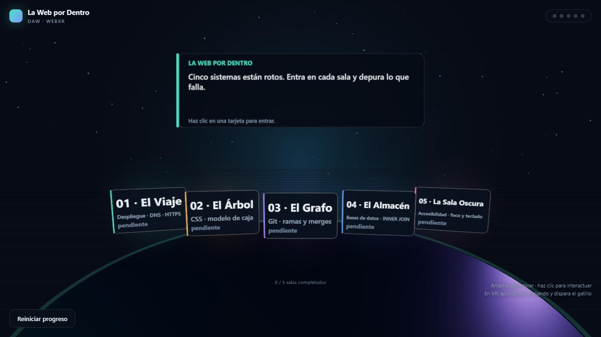
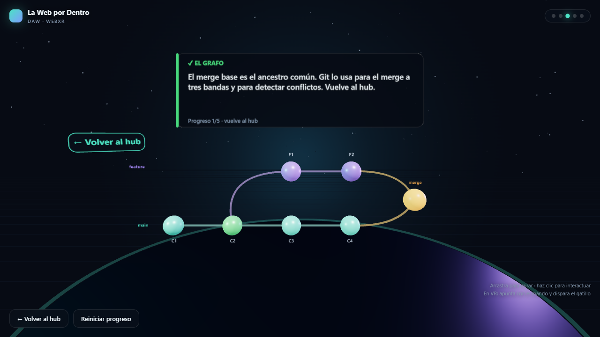

# La Web por Dentro

Juego educativo en **3D y realidad virtual** para el ciclo de **Desarrollo de Aplicaciones Web (DAW)**. Cinco salas convierten conceptos que normalmente se explican en la pizarra en objetos que se pueden mirar, tocar y depurar.

> **Demo:** https://jrubioastigarraga.github.io/la-web-por-dentro/
>
> Funciona en cualquier navegador moderno. Para VR, ábrelo en el navegador de Meta Quest y pulsa **Enter VR**.



## Las cinco salas

| # | Sala | Concepto | Módulo DAW | Qué hace el jugador |
|---|------|----------|------------|---------------------|
| 1 | **El Viaje** | DNS, HTTPS y códigos de estado | Despliegue de aplicaciones web / Sistemas informáticos | Resuelve tres pasos de una petición: registro A, puerto 443 y servidor sano (200) |
| 2 | **El Árbol** | Modelo de caja de CSS | Desarrollo web en entorno cliente / Diseño de interfaces | Identifica qué capa (`content`, `padding`, `border`, `margin`) cambia en cada ronda |
| 3 | **El Grafo** | Ramas y `merge base` de Git | Entornos de desarrollo | Encuentra el ancestro común de `main` y `feature` y ve cómo nace el merge |
| 4 | **El Almacén** | `INNER JOIN` e integridad referencial | Bases de datos | Localiza el pedido huérfano que apunta a un `cliente_id` inexistente |
| 5 | **La Sala Oscura** | Orden de tabulación y accesibilidad | Diseño de interfaces web | Recorre el formulario en el orden de foco correcto |



## Cómo se juega

**Escritorio**

- Arrastra con el ratón para mirar.
- Haz clic en tarjetas, orbes y botones para interactuar.
- `Esc` vuelve al hub.
- El progreso se guarda en `localStorage` (5/5 salas).

**Realidad virtual**

- Abre la URL en el navegador del visor (probado con el navegador de Meta Quest) y pulsa **Enter VR**.
- Apunta con el mando y dispara el gatillo para seleccionar.
- No hay locomoción artificial: cada sala es un diorama que se manipula desde el sitio. Menos mareo y sesiones de 10–12 minutos.

## Por qué así

- **Nada de escribir código en VR.** El teclado virtual es hostil. El juego trabaja lo que sí es espacial: flujos, árboles, grafos, capas y diagnósticos.
- **Depurar, no memorizar.** Cada sala plantea un sistema roto y pide una decisión; el fallo se explica al instante.
- **Sin locomoción.** El jugador permanece en el centro y todo ocurre en una mesa de hologramas a 1,2 m. Es cómodo de pie o sentado y encaja en una sesión de clase.
- **Todo procedural.** No hay modelos, texturas ni audio externos: la escena se genera con three.js y los textos con canvas. El repo pesa poco y se puede modificar sin herramientas 3D.

## Desarrollo

Requiere Node 20.19+ o 22+.

```bash
npm install
npm run dev      # http://localhost:5173
npm run build    # genera dist/
npm run preview  # sirve dist/
```

### Estructura

```
src/
  main.js            bucle, cámara, raycasting, mandos VR, ciclo de salas
  hub.js             las cinco tarjetas del hub
  hud.js             panel de instrucciones anclado a la cabeza
  util.js            tarjetas, etiquetas, orbes, audio y utilidades
  rooms/
    viaje.js         DNS / HTTPS / balanceador
    arbol.js         modelo de caja CSS
    grafo.js         ramas de Git
    almacen.js       INNER JOIN y clave foránea
    oscura.js        orden de tabulación
    index.js         registro de salas
```

### Añadir una sala

Crea un módulo en `src/rooms/` con esta forma y añádelo a `src/rooms/index.js`:

```js
export const miSala = {
  id: 'mi-sala',
  title: 'Mi Sala',
  tag: 'Módulo · concepto',
  tone: '#4de2c5',
  brief: 'Texto de entrada.',
  build(api) {
    const group = new THREE.Group();
    // api.text(), api.card(), api.say(), api.ok(), api.err(), api.complete()
    // api.after(ms, fn), api.tick(fn), api.goHub()
    return group;
  },
};
```

El hub se construye solo a partir del registro y el progreso se guarda por `id`.

## Despliegue

El workflow [`.github/workflows/deploy.yml`](.github/workflows/deploy.yml) compila y publica en GitHub Pages en cada push a `main`.

Para activarlo en un fork: **Settings → Pages → Source: GitHub Actions**.

## Accesibilidad y comodidad

- Texto de alto contraste y tamaños pensados para leerse a ~1 m.
- Interacción por rayo (ratón o mando), sin necesidad de agarrar objetos.
- Sin movimiento de cámara artificial; el jugador puede mirar libremente.
- Progreso persistente y botón de reinicio.

## Licencia

MIT. Úsalo, modifícalo y llévalo a tu aula.
