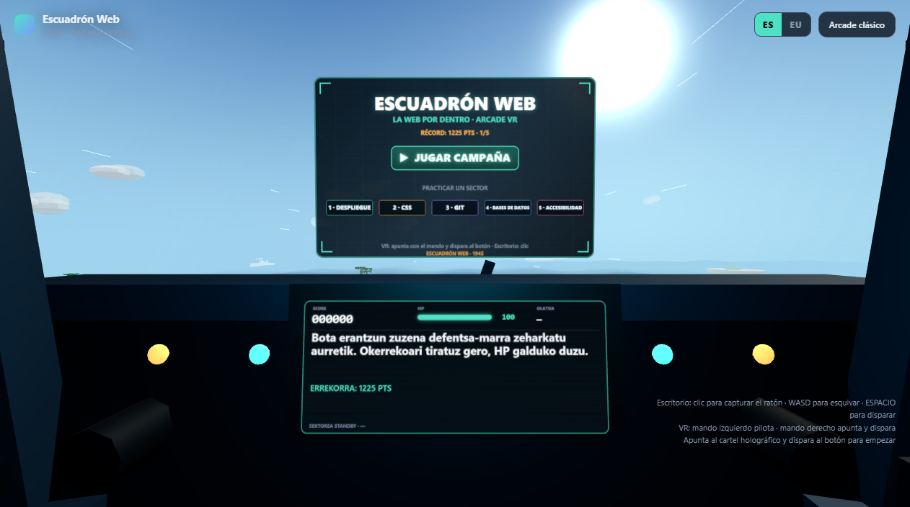
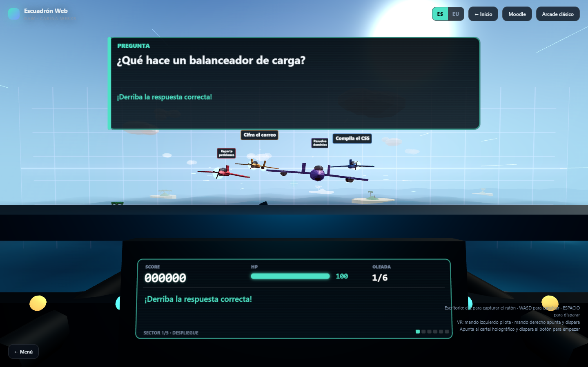
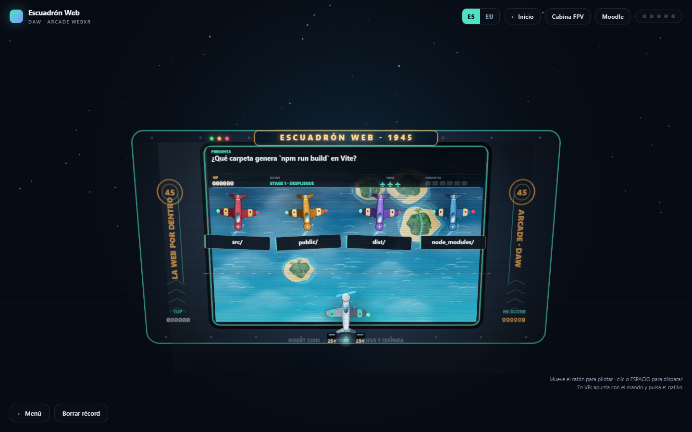
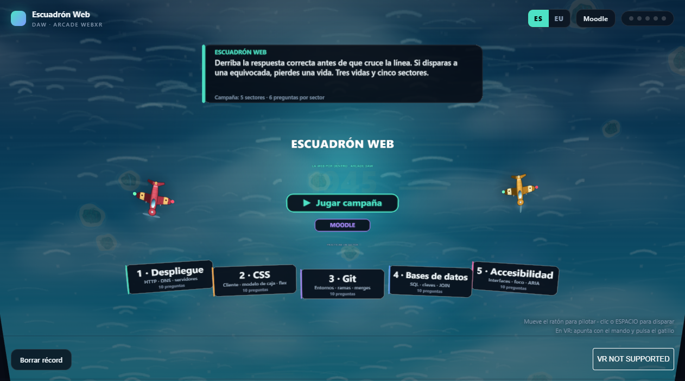

# Escuadrón Web · Cabina WebXR

[](#escuadrón-web--cabina-webxr)

Arcade educativo de **combate aéreo en 3D y realidad virtual** para el ciclo de **Desarrollo de Aplicaciones Web (DAW)**. Cinco sectores convierten los contenidos de clase en una misión de disparos: desde la cabina de tu caza hay que **derribar la respuesta correcta** antes de que cruce la línea de defensa.

La portada `index.html` es un juego completo y autocontenido que carga **Three.js y `VRButton` desde CDN mediante `importmap`**. La versión de recreativa 2D original sigue disponible en [`arcade-clasico.html`](./arcade-clasico.html).

> **Demo:** [https://jrubioastigarraga.github.io/la-web-por-dentro/](https://jrubioastigarraga.github.io/la-web-por-dentro/)

> Funciona en cualquier navegador moderno. Para VR, ábrelo en el navegador de Meta Quest o Pico 4 y pulsa **Enter VR**.



## La cabina

[](#la-cabina)

- **Vista en primera persona** dentro de un caza procedural: marco metálico, panel de instrumentos con luces emisivas, consolas laterales, cúpula de cristal y hélice girando frente al morro.
- **HUD diegético** dibujado con `CanvasTexture` sobre el panel de instrumentos: `SCORE`, `HP`, `OLEADA`, pregunta actual y explicación del resultado. Nada de menús pegados a la cara.
- **Océano infinito** con olas geométricas en shader, islas low-poly con palmeras, nubes volumétricas, estelas de velocidad, niebla y un cielo con degradado y sol.
- **Tres tipos de enemigo** que llegan de frente en formación:
  1. **Caza ligero:** rápido y en formación.
  2. **Interceptor:** esquiva en zigzag.
  3. **Bombardero pesado:** grande, con varios motores, tres impactos y proyectiles lentos de flak que se pueden esquivar o destruir en el aire.
- **Juice:** explosiones de partículas 3D, anillos expansivos, metralla, popups de puntos, destello rojo en el cristal, sacudida de cabina y **feedback háptico** en los mandos.
- **Cartel holográfico 3D** de inicio y fin de partida, con botones que se pueden **disparar con el mando VR**.



## Cómo se juega

[](#cómo-se-juega)

- Cada pregunta lanza **cuatro aviones**, cada uno con una respuesta posible. Solo una es correcta.
- La pregunta se lee en el **panel de instrumentos**; las respuestas flotan sobre los aviones.
- Derriba la respuesta correcta antes de que cruce la línea de defensa: puntos, combo y siguiente oleada.
- Si disparas a una equivocada, **pierdes 34 HP** y el HUD explica el error. Si la correcta cruza la línea, también.
- El bombardero correcto necesita **tres impactos**.
- Empiezas con **100 HP**: tres fallos te derriban. Al despejar un sector recuperas 30 HP y sumas 250 puntos.
- El récord se guarda en `localStorage`.

## Controles

[](#controles)

| Acción | VR (Meta Quest / Pico) | Escritorio |
| --- | --- | --- |
| Pilotar / esquivar | Desplaza o inclina el **mando izquierdo**; su joystick también ayuda | `A` / `D` lateral, `W` / `S` vertical, flechas |
| Apuntar | **Mando derecho**: láser y retícula 3D | Ratón (clic para capturar el puntero) |
| Disparar | Gatillo derecho (`selectstart` / `selectend`) | `ESPACIO` o clic |
| Recentrar la palanca | `squeeze` del mando izquierdo | — |
| Elegir menú | Dispara al botón holográfico | Clic en el botón |
| Volver al menú | — | `Esc` o botón **← Menú** |

En VR la cabina permanece **nivelada respecto al horizonte**: el mundo es el que se desplaza y la cabina solo se inclina unos grados (*banking*) para dar sensación de vuelo, sin rotar la cámara del usuario. Así se evita el mareo.

## Los cinco sectores

[](#los-cinco-sectores)

| \# | Sector | Contenido | Módulo DAW |
| --- | --- | --- | --- |
| 1 | **Despliegue** | DNS, HTTPS, códigos de estado, balanceadores y build | Despliegue de aplicaciones web / Sistemas informáticos |
| 2 | **CSS** | Modelo de caja, selectores, flex, unidades y responsive | Desarrollo web en entorno cliente / Diseño de interfaces |
| 3 | **Git** | Ramas, merges, comandos, stash, revert y merge base | Entornos de desarrollo |
| 4 | **Bases de datos** | SQL, claves, JOIN, tipos y transacciones | Bases de datos |
| 5 | **Accesibilidad** | HTML semántico, foco, ARIA, contraste y WCAG | Diseño de interfaces web |

Cada sector tiene **10 preguntas** en su banco, con **4 opciones** cada una. En cada partida se eligen **6 al azar** y también se barajan las opciones, así que se puede rejugar sin repetir. Cada sector cambia la luz del océano (día, atardecer, crepúsculo, frío y amanecer).

## Modos

[](#modos)

- **Jugar campaña:** los cinco sectores seguidos.
- **Practicar un sector:** una partida corta de una sola asignatura, ideal para repasar en clase.
- **Arcade clásico:** la versión de recreativa 2D con ratón, pantalla holográfica y **preguntas desde Moodle**, disponible en [`arcade-clasico.html`](./arcade-clasico.html).

## Arcade clásico

[](#arcade-clásico)

La versión de recreativa (`arcade-clasico.html`) mantiene la mecánica original y se ha renovado con una estética más cercana a **Air Force / 1942 / 1945**:

- Máquina arcade con marquesina iluminada, ranuras de monedas, marcadores `1UP`/`HI-SCORE`, remaches y máscara **CRT** (scanlines, viñeta y reflejo de cristal).
- Océano con más capas de espuma, franjas de luz y chispas; islas con palmeras dibujadas y nubes con sombreado.
- Aviones redibujados con nervaduras, escarapela, número de escuadrón, cabina brillante y morro metálico.
- Línea de defensa con chevrones parpadeantes y explosiones con más humo y metralla.
- **Power-ups**: al derribar la respuesta correcta pueden caer cápsulas `P` (cañones dobles) y `R` (recarga rápida) durante 12 segundos. Se recogen moviendo el avión y suman 50 puntos.





## Idioma

[](#idioma)

El botón **ES / EU** cambia la interfaz, el HUD, los mensajes y los títulos de sector. El banco de preguntas está en castellano; si una pregunta tuviera `qEu`, `optionsEu` y `whyEu`, se usaría su traducción. En la cabina, las preguntas se muestran tal como estén escritas en el banco.

## Preguntas desde Moodle (arcade clásico)

[](#preguntas-desde-moodle-arcade-clásico)

La cabina WebXR usa el banco local embebido para poder funcionar como un único archivo. La integración con Moodle se conserva en la versión modular:

```
Juego (HTTP)  ->  API Python  ->  Moodle (format_quizdump)
```

- Juego: **http://172.16.35.2/la-web-por-dentro/arcade-clasico.html**
- API: **http://172.16.35.2/escuadron-api**
- Plugin: `format_quizdump` (ZIP parcheado en [`moodle/format_quizdump.zip`](./moodle/format_quizdump.zip))

En la pantalla inicial del arcade clásico, pulsa **Moodle** y rellena solo:

- **API (proxy)**: `http://172.16.35.2/escuadron-api`
- **Cuestionario**: `quiz:39` (ID del quiz), `course:51` (todos los quizzes de un curso) o `cmid:7772` (el número que aparece en la URL de Moodle `mod/quiz/edit.php?cmid=7772`).

Pulsa **Guardar** para conservarlo o **Cargar y jugar** para empezar.

También por enlace, cómodo en Pico 4:

```
http://172.16.35.2/la-web-por-dentro/arcade-clasico.html?api=http://172.16.35.2/escuadron-api&quiz=quiz:39&start=1
```

Para el quiz de `https://moodle.lhusurbil.eus/mod/quiz/edit.php?cmid=7772`:

```
http://172.16.35.2/la-web-por-dentro/arcade-clasico.html?api=http://172.16.35.2/escuadron-api&cmid=7772&start=1
```

Esto hace la llamada `GET /questions?quiz=cmid:7772`. La API resuelve el cmid contra `format_quizdump` (para este quiz: **quiz id 104, curso 83**) y guarda la correspondencia en `api/data/cmid-map.json`. Si el cmid no está en caché, recorre los cursos `1..MOODLE_MAX_COURSEID` (150 por defecto); la primera resolución puede tardar unos segundos y las siguientes son instantáneas. También puedes usar directamente `quiz:104`.

Cada pregunta se convierte en **una pantalla (`STAGE`) independiente**.

Para saber los IDs:

```
http://172.16.35.2/escuadron-api/quizzes?courseid=51
```

> GitHub Pages sirve el juego por **HTTPS** y la API es **HTTP**; el navegador
> bloquea esa mezcla. Para Moodle usa la copia HTTP servida en el servidor.

El plugin `format_quizdump` expone las funciones `format_quizdump_get_quizzes`
y `format_quizdump_get_quiz_questions` con el token de Moodle. La API guarda
ese token en el servidor, nunca en el navegador.

### Sin instalar ningún plugin: exportar el cuestionario

[](#sin-instalar-ningún-plugin-exportar-el-cuestionario)

Como alternativa, exporta el cuestionario (**Banco de preguntas → Exportar →
Moodle XML**) y conviértelo con la API:

```bash
cd api
python import_moodle.py cuestionario.xml --name http
MOODLE_URL=none uvicorn main:app --host 0.0.0.0 --port 8000
```

El juego usa la API con `quiz=http` (o vacío si solo hay uno). No hace falta
token ni tocar Moodle; solo repetir la exportación cuando cambien las preguntas.

### Alternativa: plugin local `local_lwpd`

[](#alternativa-plugin-local-local_lwpd)

Si prefieres no usar token y servir un endpoint propio, existe el plugin
`local_lwpd` en [`moodle/local_lwpd.zip`](./moodle/local_lwpd.zip).
No es el que está desplegado; la vía actual es `format_quizdump` + API.

## APK para Pico 4

[](#apk-para-pico-4)

La APK está en [`android/EscuadronWeb.apk`](./android/EscuadronWeb.apk).

Es un **lanzador**: abre el juego en el navegador del Pico, que es el que ofrece
**WebXR real**. Un WebView de Android no soporta sesiones inmersivas.

1. Activa el **modo desarrollador** del Pico y permite orígenes desconocidos.
2. Instálala por USB:

   ```bash
   adb install -r EscuadronWeb.apk
   ```

   o copia el APK al Pico y ábrelo.
3. Abre **Escuadrón Web** → se abre el navegador con
   `https://jrubioastigarraga.github.io/la-web-por-dentro/` → pulsa **Enter VR**.

La URL se cambia en `android/app/src/main/res/values/strings.xml`. Por defecto
apunta a la demo pública de GitHub Pages, así que funciona fuera de la red del
instituto. Para usar la copia local con Moodle, cámbiala por
`http://172.16.35.2/la-web-por-dentro/` y vuelve a compilar la APK.

## Desarrollo

[](#desarrollo)

Requiere Node 20.19+ o 22+.

```
npm install
npm run dev      # http://localhost:5173
npm run build    # genera dist/
npm run preview  # sirve dist/
```

`index.html` no necesita compilación: puedes servirlo con cualquier servidor
estático. El `importmap` apunta a `three@0.180.0` en jsDelivr, así que también
puedes abrirlo directamente y desplegarlo tal cual.

En `npm run build`, Vite compila el arcade clásico y **copia `index.html` sin
transformarlo** para conservar su condición de archivo único.

### Estructura

```
index.html             cabina WebXR completa: render, vuelo, enemigos, HUD y menú
arcade-clasico.html    portada de la versión modular original
src/
  main.js              bucle, cámara, raycasting, mandos VR y pantallas
  menu.js              pantalla de inicio y selección de sector
  hud.js               panel de instrucciones del menú
  i18n.js              textos ES/EU y ayudas de traducción
  moodle.js            carga de preguntas por ID/cmid desde Moodle o API
  util.js              tarjetas, etiquetas, audio y utilidades
  arcade/
    questions.js       banco de preguntas de las cinco asignaturas
    art.js             mar con scroll, aviones, marcos, HUD y texturas
    game.js            motor del arcade: oleadas, disparos, vidas y sectores
api/
  main.py              API FastAPI (juego -> API -> Moodle)
moodle/
  plugin/lwpd/         plugin local local_lwpd (código fuente)
  local_lwpd.zip       plugin listo para instalar en Moodle
```

### Añadir o cambiar preguntas

En la cabina WebXR, el banco está al principio de `index.html` (constante
`SECTORS`). En la versión modular está en `src/arcade/questions.js`. Cada
pregunta tiene esta forma:

```js
['¿Qué código HTTP indica un fallo del servidor?', ['500', '404', '301', '200'], 0, '500 es un error interno del servidor.']
// [enunciado, opciones, índice correcto, explicación]
```

La respuesta correcta se baraja en cada oleada: el índice `correct` solo indica
cuál es, nunca se muestra en una posición fija ni con un color distinto.

Para cambiar cuántas preguntas tiene cada partida, ajusta `CFG.questionsPerSector`
en `index.html` o `QUESTIONS_PER_SECTOR` en `src/arcade/questions.js`.

## Despliegue

[](#despliegue)

El workflow [`.github/workflows/deploy.yml`](./.github/workflows/deploy.yml) compila y publica en GitHub Pages en cada push a `main`.

Para activarlo en un fork: **Settings → Pages → Source: GitHub Actions**.

## Accesibilidad y comodidad

[](#accesibilidad-y-comodidad)

- Texto de alto contraste y tamaños pensados para leerse desde la cabina.
- Preguntas y respuestas siempre visibles: el juego evalúa comprensión, no memoria visual.
- Interacción por rayo (ratón o mando), sin necesidad de agarrar objetos.
- Sin locomoción artificial ni giros bruscos de cámara: el jugador puede mirar libremente.
- `renderer.setAnimationLoop` + `THREE.Clock` para un *delta time* estable a 72/90/120 Hz.
- Récord persistente en `localStorage`.
- Alternativa de práctica por asignatura para sesiones cortas.

## Licencia

[](#licencia)

MIT. Úsalo, modifícalo y llévalo a tu aula.
